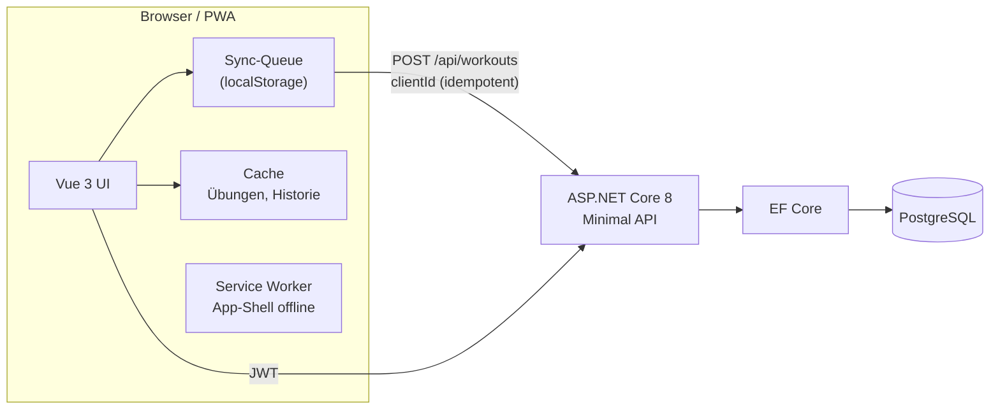

# SprintLog

[](https://github.com/took1s/SprintLog/actions/workflows/ci.yml)

**Hybrid Fitness Tracker** - eine offline-fähige Progressive Web App (PWA), die Krafttraining und Feldtraining (Fußball, Sprints, Sprünge) in einer Anwendung vereint.

Live-Demo: https://sprintlog-api.onrender.com/

> Projekt im 1. Ausbildungsjahr - Fachinformatiker für Anwendungsentwicklung.

| Übungen | Satz erfassen (Kraft) | Satz erfassen (Feld) | Überblick |
| --- | --- | --- | --- |
|  |  |  |  |

| Historie | Fortschritt | Kalender | Einheit prüfen |
| --- | --- | --- | --- |
|  |  |  |  |

---

## Inhalt

- [Features](#features)
- [Tech-Stack](#tech-stack)
- [Architektur](#architektur)
- [Lokal starten](#lokal-starten)
- [Tests und CI](#tests-und-ci)
- [Datenbank und Migrationen](#datenbank-und-migrationen)
- [API](#api)
- [Projektstruktur](#projektstruktur)
- [Herausforderungen und Lösungen](#herausforderungen-und-lösungen)
- [Ausblick](#ausblick)

## Features

**Training erfassen**
- Drei Erfassungsarten pro Übung: *Gewicht × Wiederholungen*, *Distanz + Zeit* (Sprints, Shuttles) und *Dauer* (Plank, Seilspringen).
- Live-Telemetrie beim Kraftsatz: geschätztes 1RM (Epley), Intensität in % vom Rekord, Trainingszone; Schnellwahl 70/80/90 % vom Rekord.
- Live-Telemetrie beim Sprint: km/h, m/s und Vergleich mit der eigenen Bestgeschwindigkeit.
- Vorbelegung mit dem letzten Satz, Pausentimer mit Ton und Vibration (läuft auch nach Neuladen korrekt weiter), Bildschirm bleibt während der Einheit an.
- Eigene Übungen (nur für den eigenen Account sichtbar), Favoriten, Suche, Filter und Sortierung.
- Technik-Ansicht pro Übung: animierte Figur (eigene SVG-Skelettanimation, offline, ~45 Bewegungsmuster für alle 84 Standardübungen, eigene Übungen werden über den Namen erkannt), Zielmuskulatur und 3-4 Technik-Hinweise.

**Auswertungen**
- Überblick: Einheiten und Volumen dieser Woche (mit Vergleich zur Vorwoche), Wochen-Serie, 12-Wochen-Diagramm, Muskelgruppen-Verteilung, letzte Rekorde.
- Fortschritt pro Übung: Max-Gewicht, geschätztes 1RM, Volumen bzw. Top-Speed, Bestzeit, Distanz.
- Historische Rekorde: ein Satz bekommt ein Badge, wenn er zum Zeitpunkt des Trainings den bisherigen Bestwert übertroffen hat.
- Aktivitäts-Heatmap (26 Wochen) und Rekordliste.

**Offline-first und Daten**
- Die App startet ohne Netz (Service Worker). Einheiten werden immer zuerst lokal gespeichert und automatisch synchronisiert.
- Idempotente Synchronisation über eine Client-ID: abgebrochene oder doppelte Sync-Versuche erzeugen keine Duplikate.
- Export als CSV (Excel-kompatibel) und JSON, Löschen des Accounts inkl. aller Daten (DSGVO Art. 17 und 20).
- Keine externen CDNs: Vue, Chart.js, Tailwind-CSS und die Schrift werden selbst ausgeliefert (offline-fähig, keine Datenübertragung an Dritte).

## Tech-Stack

| Bereich | Technologie |
| --- | --- |
| Backend | C# / .NET 8 Minimal API, Entity Framework Core 8 |
| Datenbank | PostgreSQL (Supabase in Produktion, Docker lokal) |
| Auth | JWT (HS256, Issuer/Audience-Prüfung), BCrypt, Rate Limiting |
| Frontend | Vue 3 (ES-Module, ohne Bundler), Tailwind CSS (Build), Chart.js |
| Tests | xUnit + WebApplicationFactory + Testcontainers (echtes PostgreSQL), Node Test Runner, Playwright (E2E) |
| CI/CD | GitHub Actions, Docker, Render |

## Architektur



Ablauf beim Speichern einer Einheit:

1. Die Einheit bekommt im Browser eine `clientId` (UUID) und das Startdatum und landet in der Queue.
2. Online wird sie an `POST /api/workouts` gesendet. Der Server prüft Eingaben und Übungs-IDs und speichert Einheit + Sätze in einer Transaktion.
3. Existiert die `clientId` für diesen Nutzer schon (z. B. weil die Antwort verloren ging), liefert der Server die vorhandene Einheit zurück statt sie doppelt anzulegen. Ein Unique-Index `(UserId, ClientId)` sichert das auch bei parallelen Requests ab.
4. Validierungsfehler markieren den Eintrag als fehlgeschlagen (sichtbar in der Historie mit "Retry"), Netzwerk- und Serverfehler werden später automatisch wiederholt.

Datenisolation: Jeder Endpunkt liest die Nutzer-ID aus dem JWT. Fremde Einheiten und Übungen liefern `404` (nicht `403`), damit keine IDs erraten werden können.

## Lokal starten

### Variante A: Docker (empfohlen, inkl. Datenbank)

Voraussetzung: [Docker Desktop](https://www.docker.com/).

```bash
git clone https://github.com/took1s/SprintLog.git
cd SprintLog
cp .env.example .env        # JWT_SECRET setzen (mind. 32 Zeichen)
docker compose up --build
```

- App: http://localhost:5111
- Swagger: http://localhost:5111/swagger
- Health-Check: http://localhost:5111/health

Die Migrationen werden beim Start automatisch angewendet (`Database__MigrateOnStartup=true`).

### Variante B: .NET direkt (z. B. gegen Supabase)

```bash
# .env im Repo-Ordner mit ConnectionStrings__DefaultConnection und JWT_SECRET (siehe .env.example)
cd SprintLog.Api
dotnet run
```

### Variante C: nur Frontend (ohne .NET und Datenbank)

Ein Mock-Backend in Node bildet die API im Speicher nach - praktisch für UI-Arbeit:

```bash
npm ci
npm run mock:demo     # http://localhost:5111, Login: demo / demo-password (mit 10 Wochen Demo-Daten)
npm run watch:css     # Tailwind neu bauen bei Änderungen
```

### Umgebungsvariablen

| Variable | Pflicht | Beschreibung |
| --- | --- | --- |
| `ConnectionStrings__DefaultConnection` | ja | PostgreSQL-Connection-String |
| `JWT_SECRET` | ja | Signierschlüssel, mindestens 32 Byte |
| `Database__MigrateOnStartup` | nein | `true` = Migrationen beim Start anwenden (Standard: `false`) |
| `Swagger__Enabled` | nein | Swagger auch außerhalb von Development anzeigen |
| `RateLimiting__AuthPermitLimit` | nein | Login-/Registrierungsversuche pro Minute und IP (Standard: 10) |

In der Cloud (Render) werden die Werte im Dashboard unter *Environment* hinterlegt.

## Tests und CI

```bash
dotnet test                 # Integrationstests gegen echtes PostgreSQL (Docker muss laufen)
npm test                    # Unit-Tests: Kennzahlen, Rekorde, Sync-Queue, CSV-Export
npm run test:e2e            # Browser-Tests (Playwright) inkl. Offline-Modus
```

Die Integrationstests starten die echte API mit `WebApplicationFactory` und eine PostgreSQL-Instanz mit Testcontainers. Getestet werden unter anderem:

- Registrierung, Login, Token-Refresh, gefälschte Tokens, Rate Limiting
- Datenisolation zwischen Nutzern (Einheiten, eigene Übungen, Favoriten)
- Idempotentes Speichern (auch 5 parallele Requests mit derselben `clientId`)
- Validierung (negative Werte, Zukunftsdatum, unbekannte Übungen, leere Einheiten)
- Zeitzonen (Datum mit Offset wird als UTC gespeichert)
- Account löschen mit allen Daten

GitHub Actions führt bei jedem Push aus: Build, Prüfung "EF-Modell passt zu den Migrationen", Backend-Tests, Frontend-Build-Check, Unit- und E2E-Tests sowie den Docker-Build.

## Datenbank und Migrationen

Die Migrationen liegen in `SprintLog.Api/Migrations`. Für Umgebungen ohne direkten Datenbankzugriff (z. B. Firmen-Firewall) gibt es ein **idempotentes SQL-Skript**: [`database/migrate.sql`](database/migrate.sql). Es kann im Supabase-SQL-Editor ausgeführt werden und überspringt bereits angewendete Migrationen.

Migration `V3UserScopedData` (Upgrade von v2):

- Favoriten: `Username` -> `UserId` als echter Fremdschlüssel. Bestehende Favoriten werden per SQL übernommen, verwaiste und doppelte Einträge entfernt.
- Übungen: `TrackingType` und `UserId` (eigene Übungen), Identity-Sequenz startet bei 1000 (IDs darunter sind für den Standardkatalog reserviert).
- Einheiten: `ClientId` (Idempotenz), `DurationSeconds`, Indizes auf `(UserId, Date)` und `(UserId, ClientId)`.
- `WorkoutSets -> Exercises` von `CASCADE` auf `NO ACTION`: eine verwendete Übung kann nicht mehr gelöscht werden und reißt keine Historie mit.

Neue Migration anlegen:

```bash
cd SprintLog.Api
dotnet tool restore
dotnet ef migrations add <Name>
dotnet ef migrations script --idempotent -o ../database/migrate.sql
```

## API

Alle Endpunkte außer Registrierung, Login und Health erfordern `Authorization: Bearer <token>`. Fehler werden als [RFC 7807 Problem Details](https://www.rfc-editor.org/rfc/rfc7807) zurückgegeben. Beispiel-Requests: [`SprintLog.Api/SprintLog.Api.http`](SprintLog.Api/SprintLog.Api.http).

| Methode | Pfad | Beschreibung |
| --- | --- | --- |
| POST | `/api/auth/register` | Konto anlegen, liefert Token |
| POST | `/api/auth/login` | Login, liefert Token |
| POST | `/api/auth/refresh` | Neuen Token ausstellen |
| GET | `/api/auth/me` | Profil und Kennzahlen |
| DELETE | `/api/auth/account` | Konto inkl. aller Daten löschen (Passwort im Body) |
| GET | `/api/exercises?category=` | Standardkatalog + eigene Übungen |
| POST | `/api/exercises` | Eigene Übung anlegen |
| DELETE | `/api/exercises/{id}` | Eigene Übung löschen (409, wenn in Verwendung) |
| GET/POST/DELETE | `/api/favorites[/{exerciseId}]` | Favoriten |
| POST | `/api/workouts` | Einheit speichern (idempotent über `clientId`) |
| GET | `/api/workouts/history` | Alle Einheiten des Nutzers |
| GET / DELETE | `/api/workouts/{id}` | Einzelne Einheit lesen / löschen |
| GET | `/health` | Health-Check inkl. Datenbank |

## Projektstruktur

```
SprintLog/
├── SprintLog.Api/              .NET 8 Minimal API
│   ├── Endpoints/              Auth, Exercises, Favorites, Workouts
│   ├── DTOs/                   Request/Response-Records inkl. Validierung
│   ├── Models/ Data/           Entities, DbContext, Seed-Katalog
│   ├── Infrastructure/         JWT-Optionen, Validierung, Health-Check
│   ├── Services/               TokenService
│   ├── Migrations/             EF-Core-Migrationen
│   └── wwwroot/                PWA (index.html, js/*, css/app.css, vendor/, sw.js)
├── tests/SprintLog.Api.Tests/  Integrationstests (xUnit, Testcontainers)
├── frontend/                   Tailwind-Quelle, Unit-/E2E-Tests, Mock-API
├── database/migrate.sql        Idempotentes SQL-Skript für Supabase
└── docker-compose.yml          API + PostgreSQL
```

## Herausforderungen und Lösungen

- **Firewall blockierte die DB-Verbindung.** Die Firmen-Firewall verhinderte den direkten Datenbankzugriff aus der IDE. Lösung: idempotentes SQL-Skript, das im Supabase-SQL-Editor ausgeführt werden kann, und eine lokale Docker-Datenbank für die Entwicklung.
- **JWT enthielt keine eindeutige Nutzer-ID.** Anfangs steckte nur der Benutzername im Token. Lösung: User-ID als Claim, Auslesen in allen Endpunkten, Favoriten zusätzlich per Migration von Username auf UserId umgestellt.
- **Offline gespeicherte Einheiten bekamen das falsche Datum.** Der Server setzte das Datum beim Synchronisieren. Lösung: Das Startdatum kommt vom Client, der Server prüft es auf Plausibilität.
- **Doppelte Einheiten bei instabiler Verbindung.** Kam die Antwort des Servers nicht an, wurde erneut gesendet. Lösung: Client-ID + Unique-Index, der Server antwortet idempotent.
- **App funktionierte offline nicht vollständig.** Tailwind und Chart.js kamen vom CDN und waren offline nicht verfügbar. Lösung: Tailwind wird zur Build-Zeit erzeugt, alle Bibliotheken liegen in `wwwroot/vendor` und werden vom Service Worker vorgeladen.
- **Feldübungen hatten keine Eingabefelder.** Für Distanz/Zeit gab es im Dialog keine Felder, außerdem waren Kraftübungen in der Kategorie "Football" (z. B. Trap Bar Deadlift) falsch als Zeitübung behandelt. Lösung: `TrackingType` pro Übung in der Datenbank.

## Ausblick

- Trainingspläne und Vorlagen (z. B. "Push / Pull / Legs", "Sprint-Tag")
- Körpergewicht und Wellness-Daten (Schlaf, Müdigkeit) für eine Belastungssteuerung
- Teilen von Rekorden und Mannschafts-Ansicht für das Team

---

_Erstellt von [took1s](https://github.com/took1s)._
